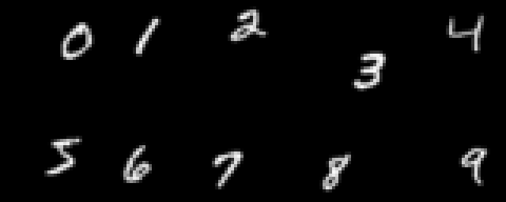
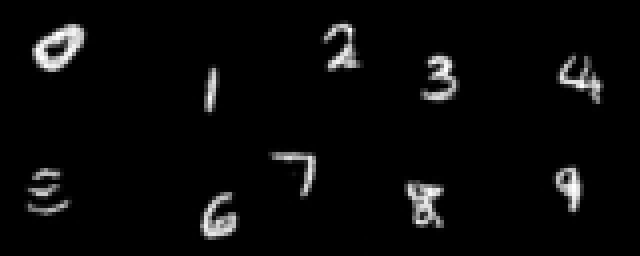

# video-dit

A video diffusion transformer written from scratch in PyTorch — per-frame patchify, 3D rotary
embeddings, adaLN-Zero conditioning, flow-matching training — trained on a synthetic
Moving MNIST-style dataset (one digit per clip) at 32×32, 8 frames.

I built this to see what changes when a DiT goes from images to video: how patches, positions and
conditioning extend to a time axis. It stays in pixel space because at 32×32 a VAE would be a
second model to train and debug while saving little compute. The data is synthetic so the motion
is known exactly: each digit moves at a constant velocity and bounces off the edges, so a wrong
sample is easy to spot by eye.

| Training clips | Samples |
| :---: | :---: |
|  |  |

## Results

Left, one training clip per digit. Right, class-conditional samples, one clip per digit (top
row 0–4, bottom row 5–9), 50 Euler steps, CFG 2.0, from a 40,000-step run on 20k clips.

`evaluate.py` scores 100 sampled clips (10 per digit). Label accuracy and frame agreement come
from a small frame classifier trained on the real clips:

| Clips | Label accuracy | Frame agreement | Motion |
| :--- | :---: | :---: | :---: |
| Real, 2,000 held out | 0.97 | 0.99 | 1.00 |
| Sampled, live weights | 0.87 | 0.89 | 0.36 |
| Sampled, EMA weights | 0.79 | 0.80 | 0.29 |

Label accuracy is the share of clips that show the requested digit; frame agreement is the share
of frames that show the same digit as the clip as a whole, so a digit that morphs mid-clip
scores low. The weakest digit is 5 (4 of 10 with the live weights).

Motion checks the rule the data was made with. `evaluate.py` finds the integer shift between
each pair of frames, fits the closest constant-velocity path with bounces per axis, and reports
the share of frame steps that lie on it. Real clips score 1.00 by construction. Sampled digits
keep moving, but drift off a constant-velocity path by a pixel here and there: only 1 of 100
sampled clips has all 7 steps on the path. Motion is the weakest part of the model.

## How it works

- **Patchify** — `Conv3d` with kernel and stride `(1, p, p)`: no temporal patching, so all 8
  frames keep their own positions. 8×8×8 = 512 tokens per clip.
- **3D RoPE** — head dim split three ways across (t, y, x): each axis gets its own block of 12 of
  the 36 channels per head, with the same 6 frequencies in each block, so positions on different
  axes don't collide. Applied to q and k inside every block.
- **DiT blocks** — adaLN-Zero: timestep and label embeddings produce shift, scale and gate; the
  last layer of each modulation is zero-initialised so every block starts as the identity.
- **Flow matching** — `x_t = (1−t)·x₀ + t·x₁`, target `x₁ − x₀`, Euler sampling.

## Run it

```bash
pip install -r requirements.txt
python train.py --steps 40000                          # full run, ~8.5 h
python sample.py --ckpt checkpoints/step_040000.pt     # writes frames/grid.gif
python evaluate.py --ckpt checkpoints/step_040000.pt   # label accuracy and motion of samples
python data.py                                         # writes illustrations/grid.gif
```

The first run downloads MNIST through scikit-learn and caches the generated clips in `cache/`.
`train.py` picks mps, then cuda, then cpu; `--device` overrides it. Times above are for an
Apple M4 with torch 2.13.

## Limitations

- Pixel space, no VAE. Real systems compress temporally first; here every 4×4 patch of every
  frame is a token, so 32×32 × 8 frames is 512 tokens but 256×256 × 16 frames would be 65,536,
  and attention cost grows with the square of that.
- 32×32, 8 frames, synthetic data: a small, fully controlled setting. It says nothing about real
  video, longer clips or scale.
- Single device, no distributed training.
- No video metric such as FVD; the numbers are a frame classifier's label scores and a motion
  check, both from `evaluate.py` on 100 samples.
- `sample.py` uses the live weights. The EMA weights that `train.py` also saves scored lower at
  40k steps: with decay 0.9999 they still average over roughly the last 10k steps, while the
  model is still improving.
